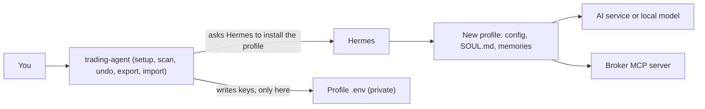

# trading-agent

> [!NOTE]
> Status: built and tested against a Hermes shim and against Hermes 0.23.1 on Linux. Not yet used by anyone outside the maintainer's testing. Treat it as an early release and read the output before you answer yes.

**A setup tool that builds a [Hermes](https://hermes-agent.nousresearch.com) agent profile for trading research from the AI access and broker tools you already have, and moves that agent to a new computer without moving a single key.**

It creates one new Hermes profile (a self-contained folder with its own settings, memories and private `.env` key file), asks before it uses anything it finds, and never shows a key. It also ships the small profile files Hermes installs: `distribution.yaml`, `SOUL.md` and `config.yaml`.

## At a glance

| Question | Answer |
|---|---|
| What do I run? | `trading-agent setup` (also `undo`, `scan`, `export`, `import`) |
| What do I need first? | Python 3.11 or newer, and Hermes 0.23.0 or newer |
| What does it change? | One new Hermes profile. No other app, no other profile |
| Where do keys go? | Only the new profile's private `.env` file (mode 0600) |
| Is anything required? | No. No AI, no broker, no data keys all finish |
| Does it include trading rules? | No. See [What is not included](#what-is-not-included) |

## Five-minute start

1. Install Hermes. The tool never installs it for you and never runs this command; you do:

   ```bash
   curl -fsSL https://hermes-agent.nousresearch.com/install.sh | bash
   hermes --version
   ```

2. Install this tool from the repository (replace `<repo-url>` with the address of this repository). Install the packaged tool, not a working copy; the reason is in [SETUP](docs/SETUP.md#why-not-run-it-from-a-checkout).

   ```bash
   uv tool install "git+<repo-url>"
   trading-agent scan
   ```

   `scan` lists what setup could find (AI tools, key names, other apps' MCP settings, local model ports). It prints names only, never values.

3. Run the wizard:

   ```bash
   trading-agent setup
   ```

   It opens like this. The picture and the text transcript come from a real run against a test copy of Hermes, regenerated by `scripts/render_transcript.py`.

   

   <details>
   <summary>Plain-text version of the whole run</summary>

   The full `setup` run for Alpaca with a fake key is in [setup.txt](docs/transcripts/setup.txt). The other commands have transcripts too: [scan](docs/transcripts/scan.txt), [export](docs/transcripts/export.txt), [import](docs/transcripts/import.txt) and [undo](docs/transcripts/undo.txt). Keys are always shown as `[hidden]`.

   </details>

4. Setup ends with a list of what it did and what is left to finish later. To remove everything it created:

   ```bash
   trading-agent undo --profile <profile>
   ```

Step-by-step with what each screen asks: [SETUP](docs/SETUP.md).

## How it fits together



Look at the keys arrow: the tool writes keys to one private file in the new profile and nowhere else. Once you use the agent, Hermes talks to the AI and broker services you picked; this tool is not part of that path.

## What stays on your machine

- **Keys** go into the new profile's private `.env` file and nowhere else. `config.yaml` holds only `${NAME}` references. Details and removal: [KEYS](docs/KEYS.md).
- **Detection is by name.** Setup reports that something exists (a CLI, a key called `OPENROUTER_API_KEY`), never its value. A key it finds is not used until you say yes for that one use.
- **Setup works offline.** A check that needs the internet says "Needs internet" and is listed under "Left to finish later". Once you use the agent, Hermes talks to the AI and broker services you picked.
- **Export and import never carry keys.** A bundle is a file you move yourself; it is not encrypted. See [MOVING](docs/MOVING.md).
- **A profile is not a security sandbox.** It separates settings and data. The agent runs with your user account's file access.

## What is not included

> [!WARNING]
> There are no trading rules in this project. No order limits, no position caps, no stop logic, no risk text, no persona. Do not read the setup flow as a risk control.

- The agent is Hermes plus the broker MCP server (a program that gives the agent a broker's tools) you pick. What it can do with your account is whatever that connector allows.
- Paper or live is your per-broker choice, made on that broker's side.
- `SOUL.md` is four neutral lines: be direct, say when unsure, use only the tools you chose, never print secrets.
- Only brokers with a curated overlay (Alpaca and Tradier) are installable from the wizard in this version. The rest of the catalog is searchable and shows "setup details not curated yet".
- A signed-in AI CLI (Claude Code, Codex and similar) cannot power the Hermes brain in this version. The wizard says so; pick a local model or an API key.

## Docs

The full index is [docs/README.md](docs/README.md).

| Page | Read it for |
|---|---|
| [SETUP](docs/SETUP.md) | Install and first run, screen by screen |
| [KEYS](docs/KEYS.md) | Where keys live and how to remove them |
| [UPDATING](docs/UPDATING.md) | Updating the profile, and what is kept |
| [MOVING](docs/MOVING.md) | Export and import to a new computer |
| [THIRD_PARTY](THIRD_PARTY.md) | Licenses and attribution |

## License

MIT, provisional until the maintainer confirms it. See [LICENSE](LICENSE).

## Related docs

- [Docs index](docs/README.md): every page with one line each.
- [Setup](docs/SETUP.md): the first thing to read after this page.
- [Third-party notices](THIRD_PARTY.md): what is referenced and under which license.
