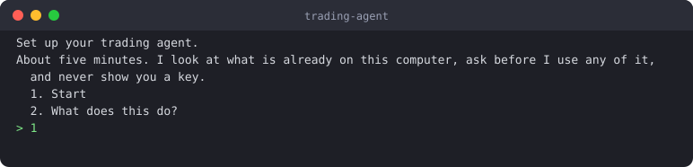
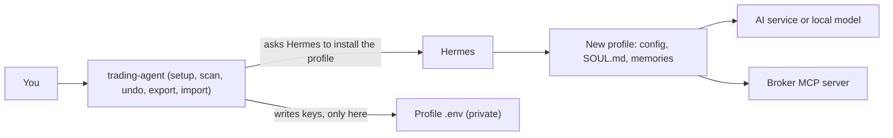

# trading-agent

> [!NOTE]
> Status: built and tested against a Hermes shim and against Hermes 0.23.1 on Linux. Not yet used by anyone outside the maintainer's testing. Treat it as an early release and read the output before you answer yes.

**A setup tool for [Hermes](https://hermes-agent.nousresearch.com) (an open-source AI agent runner). It builds an agent profile for trading research from the AI access and broker tools you already have, and exports it to a new computer as one file that holds no keys.**

**Who it is for:** someone who wants a trading-research agent without hand-editing config files, and who is fine reading each prompt before answering yes.

**What you get in five minutes:** one new Hermes profile (a folder with its own settings, memories and `.env` key file), made by a wizard that looks first, asks before it uses anything it finds, and never prints a key value. It also ships the three small profile files Hermes installs: `distribution.yaml`, `SOUL.md` and `config.yaml`.

> [!WARNING]
> Trading involves risk of loss and nothing here is financial advice. The tool only wires an AI to a broker connector you choose. It adds no trading rules and no risk controls, and a broker connector can place real orders if you connect a live account.

## At a glance

| Question | Answer |
|---|---|
| What do I run? | `trading-agent setup` (also `undo`, `scan`, `export`, `import`) |
| What do I need first? | Python 3.11.4 or newer, and Hermes 0.23.0 or newer |
| What does it change? | One new Hermes profile (`import` makes a `~/.local/bin/<profile>` shortcut; `setup` made none in a test run on Hermes 0.23.1), plus this tool's own progress and receipt files. No other app, no other profile |
| Where do keys go? | This tool writes them only to the new profile's `.env` file (mode 0600). Hermes and the connectors you pick then use them |
| Is anything required? | No. No AI, no broker, no data keys all finish |
| Does it include trading rules? | No. See [What is not included](#what-is-not-included) |

## Five-minute start

1. Install Hermes. You run this; the tool never does:

   ```bash
   curl -fsSL https://hermes-agent.nousresearch.com/install.sh | bash
   hermes --version
   ```

2. Install this tool from this repository's `portable-agent` branch (the default branch still holds the older project until the maintainer finishes the swap, see [Swap](docs/SWAP.md)). Install the packaged tool, not a working copy; the reason is in [Setup](docs/SETUP.md#why-not-run-it-from-a-checkout).

   ```bash
   uv tool install "git+https://github.com/mphinance/trading-agent.git@portable-agent"
   trading-agent scan
   ```

   `scan` lists what setup could find (AI tools, key names, other apps' MCP settings, local model ports). It prints names only, never values. To do that it starts your login shell, runs `--version` on any AI CLI it finds, reads other apps' MCP config files and checks a few local ports; see [what stays on your machine](#what-stays-on-your-machine).

3. Run the wizard:

   ```bash
   trading-agent setup
   ```

   It opens like this. The picture and the text transcript come from a recorded run against a test stand-in for Hermes, regenerated by `scripts/render_transcript.py`.

   

   <details>
   <summary>Plain-text version of the whole run</summary>

   The full `setup` run for Alpaca with a fake key is in [setup.txt](docs/transcripts/setup.txt). The other commands have transcripts too: [scan](docs/transcripts/scan.txt), [export](docs/transcripts/export.txt), [import](docs/transcripts/import.txt) and [undo](docs/transcripts/undo.txt). Keys are always shown as `[hidden]`.

   </details>

4. Setup ends with a list of what it did and what is left to finish later. To remove what it created (this deletes the profile's memories too):

   ```bash
   trading-agent undo --profile <profile>
   ```

Next: [Setup](docs/SETUP.md) walks through each screen.

## How it fits together



The keys arrow is the one to check: the tool writes keys to one file in the new profile and nowhere else. Once you use the agent, Hermes and the connectors you picked read that file and talk to the AI and broker services; this tool is not part of that path.

## Which brokers

The broker list comes from [awesome-broker-mcp](https://github.com/mphinance/awesome-broker-mcp), a CC0 community catalog of broker MCP servers (76 broker entries + 14 aggregators + 4 readme-only = 94 in all). An MCP server is a program that gives the agent a set of tools. Today the wizard installs only Alpaca and Tradier itself (curated entries); the rest are searchable and show "setup details not curated yet". To add or fix an entry, change it in the catalog repository.

## What stays on your machine

- **Keys** are written by this tool into the new profile's `.env` file (mode 0600) and nowhere else. `config.yaml` holds only `${NAME}` references. Mode 0600 stops other user accounts, not the agent: Hermes loads that file, the agent runs as you, and the broker connector you pick receives the keys you list for it. Details and removal: [Keys](docs/KEYS.md).
- **Detection is by name.** Setup reports that something exists (a CLI, a key called `OPENROUTER_API_KEY`), never its value. Setup uses a key it finds only after you say yes for that one use. To look, `scan` starts your login shell (which runs your shell startup files), runs `--version` on AI CLIs it finds, reads the MCP config files of Claude Code, Claude Desktop and other apps for server and variable names, and connects to a few loopback ports. It sends nothing over the network.
- **Setup works offline.** A check that needs the internet says "Needs internet" and is listed under "Left to finish later". Once you use the agent, Hermes talks to the AI and broker services you picked, and a broker connector that runs through `uvx` or `npx` may download its code from the network.
- **Export and import do not carry keys on purpose, and the check is best effort.** A bundle is a file you move yourself; it is not encrypted, and a key hidden in a memory in an unusual form can still ship. Read what you export. See [Moving](docs/MOVING.md).
- **A profile is not a security sandbox.** It separates settings and data. The agent runs with your user account's file access, so it can read the profile's `.env` and any other file you can.

## What is not included

> [!WARNING]
> There are no trading rules in this project. No order limits, no position caps, no stop logic, no risk text, no persona. Do not read the setup flow as a risk control.

- The agent is Hermes plus the broker MCP server (a program that gives the agent a broker's tools) you pick. What it can do with your account is whatever that connector allows, and the agent can call those tools, order tools included, on its own judgment. Hermes lists a connector's order tools whether or not the key is valid.
- Paper or live is your per-broker choice, made on that broker's side. The wizard shows the broker's own paper-trading setting but does not force it. Use paper first and read the broker's page.
- A broker connector is third-party code that runs on your computer or a hosted server, with the keys you give it. This tool does not audit it. Its "Official" or "made by a third party" label is the catalog's own claim, copied from the awesome-broker-mcp catalog and [UNVERIFIED] by this project. Check the broker's own site before you trust a connector with an account.
- `SOUL.md` is four plain lines for the model: be direct and concise, say when unsure, do not invent data, use only the chosen tools, do not print secrets. It is an instruction to a language model, not an enforced rule.
- Only brokers with a curated overlay (Alpaca and Tradier) are installable from the wizard in this version. The rest of the catalog is searchable and shows "setup details not curated yet".
- A signed-in AI CLI (Claude Code, Codex and similar) cannot power the Hermes brain in this version. The wizard says so; pick a local model or an API key. Detection of those CLIs is detect-only: this tool does not read or copy their sign-ins.
- The broker catalog is a snapshot (each entry shows a last-checked date) and brokers change. Skill libraries you pick are recorded by name only; each has its own license, see [Third-party notices](THIRD_PARTY.md).

## Docs

Read in this order. The full index is [Docs index](docs/README.md).

| Order | Page | Read it for |
|---|---|---|
| 1 | [Setup](docs/SETUP.md) | Install and first run, screen by screen |
| 2 | [Keys](docs/KEYS.md) | Where keys live and how to remove them |
| 3 | [Moving](docs/MOVING.md) | Export and import to a new computer |
| 4 | [Updating](docs/UPDATING.md) | Updating the profile, and what is kept |
| Reference | [Third-party notices](THIRD_PARTY.md) | Licenses and attribution |
| Maintainer | [Publish checklist](docs/PUBLISH_CHECKLIST.md), [Swap](docs/SWAP.md) | Pages for the repository owner, not for users |

## License

MIT. See [LICENSE](LICENSE). Third-party licenses and the one open lineage question are in [THIRD_PARTY](THIRD_PARTY.md).

## Related docs

- [Setup](docs/SETUP.md): read this next; install and the first run.
- [Docs index](docs/README.md): every page with one line each.
- [Third-party notices](THIRD_PARTY.md): what is referenced and under which license.
