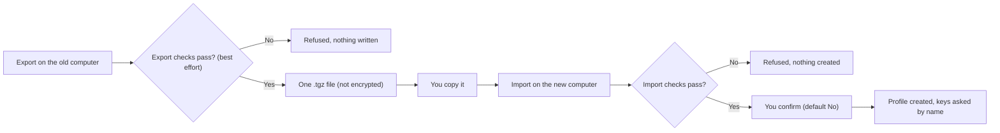

# Moving your agent to a new computer

> [!NOTE]
> Status: built in v1 (`trading-agent export` and `trading-agent import`). Linux first.

**How to carry an agent's memories, persona, settings and skills to another computer in one file, without carrying any key.**

## At a glance

| Step | Where | Command |
|---|---|---|
| 1. Export | old computer | `trading-agent export --profile <profile> -o <profile>.tgz` |
| 2. Copy the one file | your choice | USB stick, your own cloud folder, `scp` |
| 3. Install | new computer | Hermes, then this tool (see the [README](../README.md)) |
| 4. Import | new computer | `trading-agent import <profile>.tgz` |
| 5. Re-enter keys | new computer | the import asks for each key by name; skip any and add it later |



Follow the two diamonds: each is a check that can stop the move before anything is written, and the file in the middle is the only thing you carry.

> [!CAUTION]
> A bundle is **not encrypted**. It holds your memories and persona in plain text. Treat it like a private document: do not post it, and delete stray copies when you are done.

## In this doc

- [What a bundle holds](#what-a-bundle-holds)
- [Step 1: export](#step-1-export)
- [Step 2: copy the one file](#step-2-copy-the-one-file)
- [Step 3: install on the new computer](#step-3-install-on-the-new-computer)
- [Step 4: import](#step-4-import)
- [Step 5: finish later, or undo](#step-5-finish-later-or-undo)
- [Safety checks on import](#safety-checks-on-import)
- [Honest limits](#honest-limits)

## What a bundle holds

| Included | Not included |
|---|---|
| `memories/` (what the agent remembers) | Keys and secret settings (`.env`) |
| `SOUL.md` (the agent's persona) | Sign-ins and OAuth tokens (`auth.json`) |
| `config.yaml` (settings, MCP server entries) | Chat history (`sessions/`), `logs/`, `workspace/`, `cron/`, `plans/` |
| `skills/` you added or changed | Stock skills Hermes seeded and you never changed, with `skills/.bundled_manifest` and `skills/.hub/` (Hermes adds them again on the new computer) |
| `bundle.json`: a short description with the **names** of the keys to re-enter | The link to the distribution it was installed from (`distribution.yaml`) |
| | The tool's ownership marker (the importer makes a new one) |

`config.yaml` can contain web addresses (a provider's base URL, an MCP server URL) and the **names** of settings such as `${ALPACA_API_KEY}`. Values belong in the profile's private `.env` file, which never goes in a bundle, and the export enforces that: it refuses a `config.yaml` that writes a value out in full where a key belongs (see below).

## Step 1: export

```bash
trading-agent export --profile <profile> -o <profile>.tgz
```

A real run is in [export.txt](transcripts/export.txt).

- `--profile` can be left out when setup made only one profile; with several, the tool asks which one.
- Without `-o`, the file is written to the current folder as `<profile>-<date>-<time>.tgz`. The output file must not exist yet. The tool never overwrites; it writes to a temporary file and moves it into place, readable only by you (mode 0600).
- Afterwards it prints `This contains: ...` and `It does not contain: keys, sign-ins.`, plus the key names you will re-enter.

The rule has two levels. Every message names the file or the setting, never the value.

**Refused, nothing written.** Each file is read as it is on your disk, and compared with what Hermes' own export made of it. Hermes rewrites text files (`.md`, `.txt`, `.yaml`, `.json` and similar) wherever something looks like a key, so **any difference between a file and Hermes' copy of it refuses the export**: a real key would otherwise go out in part (its first 6 and last 4 characters). A placeholder shaped like a key (`password: example123`) trips this too; edit it. `config.yaml` is the one exception: it passes its own stricter checks on the disk copy (below), and that disk copy is what goes into the bundle.

Four things refuse an export. For each: what trips it, an example, and what to do.

- **A file is named like a credential.**
  - Example: `.env.local`, `auth.json`, `*.pem`, `*.key`, `token*` anywhere in the profile.
  - Do this: move the file out of the profile.
- **A file holds a value from the profile's `.env`.**
  - Example: a memory that quotes your API key.
  - Do this: edit that file.
- **A file holds a high-confidence key shape, or a secret written after its name.**
  - Example: `sk-...` (also `sk-or-...`), `Bearer ...`, `ghp_...`, `github_pat_...`, `xoxb-...`, `AKIA...`, `AIza...`, `glpat-...`, a PEM private key, a JWT, `user:password@` in a URL, a long value in a key-named URL parameter; `db password: Kq8...`, `the token is ...`, `api_key = ...` (a value of 8 or more characters with letters and digits).
  - Do this: edit that file.
- **`config.yaml` writes a value out in full where a key belongs.**
  - Example: `api_key: hunter2pass`; a value after a key-like flag in any `args` list (`--api-key X`, `--token X`, `-k X`, `--client-secret X`) or in `--token=X`, including `args` written as one string; a number, date or binary value under a key-like name (singular or plural: `tokens`, `passwords`, `api_keys`, also `signature`, `bearer`); any value under a key-like parent such as `credentials:`, `auth:`, `secrets:`, `password:`; any literal inside an `env:`, `headers:`, `default_headers:`, `extra_headers:`, `docker_env:` or other `*_env` / `*_headers` map. Hermes' own non-secret settings with such names (`voice.record_key`, `desktop.password_store`, `auth.codex_login_flow`, `proxy.credential_source`, `vault.key_storage` and the like) are fine.
  - Do this: move the value to the profile's `.env` file and write `${NAME}` in its place.

**Named warning, you decide (the answer defaults to No):** a plain long hex or base64 run, or a token-like web address value, in one of your own files. This is usually a hash or an example. The export lists each file and why, then asks `Export them as they are? [y/N]`.

Values shorter than 8 characters (`true`, `paper`) are settings, not keys, and are not compared with your `.env`. In `config.yaml`, `true`, `false`, empty values, `${NAME}` and `Bearer ${NAME}` are fine; so are key-like names whose value is a name, address, kind or count (`key_env`, `token_url`, `auth_type`, `token_limit`), also under a key-like parent.

### A readable folder instead

```bash
trading-agent export --profile <profile> --files <folder>
```

This writes the same snapshot as plain files (`memories/`, `SOUL.md`, `config.yaml`, `skills/`, `bundle.json`) into a new or empty folder, so you can read it, copy it, or keep it in your own version control. Use the one-file bundle to move; `import` reads bundle files only.

## Step 2: copy the one file

Any way you like. The file is usually small (memories and skills are text). Prefer a channel only you can read.

## Step 3: install on the new computer

Install Hermes and this tool as the [README](../README.md) describes. You do not need to run `trading-agent setup` first.

## Step 4: import

```bash
trading-agent import <profile>.tgz
trading-agent import <profile>.tgz --name <new-name>
```

A real run, including the hidden key prompts, is in [import.txt](transcripts/import.txt).

What happens, in order:

1. The whole file is checked before anything is created (see [Safety checks](#safety-checks-on-import)). A bad file gives one plain line and nothing is written.
2. You see what the bundle contains, and what happens to its `config.yaml`: some settings refuse the whole import, an allowlist is brought in, the rest is dropped and listed. The rules are in [How import treats config.yaml](#how-import-treats-configyaml).
3. If the name is taken, by a Hermes profile or by a command of that name on this computer, you pick another name or go back. An existing profile is never overwritten.
4. You confirm. The answer defaults to No.
5. Keys: one hidden prompt per key name. Paste it, or press Enter to skip. Keys found in your environment are **not** offered for reuse during import; type them or add them later.
6. The name is checked once more, then Hermes creates the profile and the tool records a setup receipt.

If anything fails, or you press Ctrl-C, after the profile was created, it is removed again (with Hermes' command alias), so the name is free for another try. Going back or answering No ends the import with nothing created and is not an error (exit code 0).

### How import treats config.yaml

| Kind of setting | What import does |
|---|---|
| Runs a program at start, or weakens command approvals | Refuses the whole import |
| On the allowlist of single settings | Brought in |
| Anything else | Dropped and listed |
| MCP servers and provider addresses | Shown in full before you confirm |

<details>
<summary>Full rules for each kind</summary>

- **Refused outright** (the whole import stops): settings that run a program every time Hermes starts or weaken command approvals: `secrets.command.enabled`, `skills.inline_shell`, a wildcard or glob in `command_allowlist`, `delegation.subagent_auto_approve`, `plugins.host.launcher`, `terminal.shell_init_files`, `security.redact_secrets` set to anything but true, `hooks_auto_accept` set to anything but a plain false, and `approvals.mode` set to anything but `manual` or `smart` (Hermes reads bare `y`, `n`, `on`, `off` as booleans, so those count too).
- **Brought in:** only an allowlist of single settings (leaves), taken from Hermes' own default config and its provider code. A setting keeps a plain value only (text, a number, true or false, empty, or a list of those); a whole section is never brought in by name. The list covers:
  - the model and provider choice: `model.provider`, `model.default`, `model.base_url`, `model.context_length` and similar tuning values; for each entry under `providers`, `custom_providers` and `fallback_providers`: `name`, `provider`, `model`, `base_url` (or `url`, `api`), `api_key` (a `${NAME}` reference only), `key_env` (a variable name only), `api_mode`, `context_length` and similar;
  - `auth.adopt_external_logins`, `fallback.min_switch_reset_seconds`;
  - `context.engine` only when it is exactly `compressor` (Hermes loads any other engine name as Python code from a folder), and the `context.memory_trim` numbers;
  - `display.skin` and `display.pet.slug` only as plain names (letters, digits, `-`, `_`, `.` not first, at most 64 characters), because Hermes builds a file path from them;
  - no text setting holding `${...}` (in any form Hermes reads: `${NAME}`, `${env:NAME}`, `${ name }`), because Hermes replaces it with the value from the profile's `.env` file and would put a key into a prompt, onto the screen or into an address. Such a setting is dropped and listed. The exceptions are `api_key`, `key_env` and `api_key_env` at their named provider and model positions only (`model.api_key`, `providers.<name>.key_env` and the like, never a name the bundle picks such as a personality called `api_key`), where a reference is how a key is meant to be named, and `mcp_servers`, which is shown in full;
  - display and UI switches, memory switches and limits (not `memory.provider` or `memory.write_approval`), compression and streaming numbers, tool output limits, personalities (name and prompt text), timezone, privacy, goals and loop limits, vision limits, a few agent knobs (`agent.max_turns` and similar) and `skills.template_vars` (on or off);
  - `mcp_servers`, kept whole and always shown (below).
- **Dropped and listed:** every other setting, at any depth. That includes whole sections such as `terminal`, `browser`, `gateway`, `cron`, `plugins`, `security`, `delegation`, `secrets`, `vault`, `lsp`, `desktop`, `hooks`, `quick_commands`, `approvals`, `command_allowlist`, `prefill_messages_file`, and single settings inside allowed sections such as `model.codex_bin`, `model.openai_runtime`, `providers.<name>.key_cmd`, `providers.<name>.ssl_verify`, `providers.<name>.ssl_ca_cert`, `display.status_phrases`, `context.engine` with any value but `compressor`, and any setting Hermes does not define. The tool says `These settings were not imported: <key paths>` before you confirm and again after the import. Add any of them yourself with `hermes config set` if you trust them.
- **Shown before you confirm:** each MCP server with its command and arguments or its address, its folder (`cwd`), each `env` setting with the `${NAME}` it reads, its secure connection settings (`ssl_verify`, `client_cert` and the like), and the names of any other settings it carries; every provider address, said plainly to **receive that provider's API key** (Hermes sends the provider's key to a `base_url` set in `config.yaml`, also when no key name appears next to it); each `${NAME}` or `key_env` that would be sent to one of those addresses, with the setting it comes from; any program setting or secure connection setting that is still there. These can run programs on your computer or send your keys somewhere. The summary is best effort: import only a bundle you made or trust.
- **The written `config.yaml` is always rewritten** from the settings that were checked, even when nothing was dropped, so the file Hermes reads is exactly what was checked. Comments in it are not kept. A `config.yaml` that repeats a setting name, or has a setting name that is not text, is refused (Hermes refuses repeated names too). Bare `y`, `n`, `yes` and `off` are read as true or false, the way Hermes reads them (YAML 1.1). When the file is written, text that Hermes would read as a number (`1e3`, `1.0e3`, `1_000`) or that would make Hermes reject the whole file (`._`, `+_`) is quoted, so it stays text.

</details>

## Step 5: finish later, or undo

The import lists the keys you skipped under `Left to finish later:`. Add each one to the profile's private `.env` file (`NAME=value`, one per line) when you have it.

To remove an imported profile completely:

```bash
trading-agent undo --profile <profile>
```

## Safety checks on import

A bundle from anyone else is untrusted input. These checks guard against a malformed or oversized archive, files outside the allowed set and risky `config.yaml` settings. They do not judge what the memories, `SOUL.md` and skills say; see [What import trusts](#what-import-trusts). Before anything is written:

| Check | Limit |
|---|---|
| Bundle file size (compressed) | 50 MB |
| `bundle.json` size | 64 KB |
| Profile archive inside the bundle (compressed) | 50 MB |
| Profile archive once expanded | 200 MB |
| One file in the profile archive | 50 MB |
| Entries in the profile archive | 5000 |
| Compression ratio (past the first 1 MB) | 100 to 1 |

- The bundle must hold exactly `bundle.json` and `profile.tar.gz`, both plain files.
- Every entry must be a plain file or folder: no links, devices or pipes; no absolute paths, `..`, backslashes or control characters; no duplicate names (also ignoring case).
- The profile archive may hold only `SOUL.md`, `config.yaml`, `memories/` and `skills/`. Anything else, such as `.env`, `auth.json`, chat history, scheduled jobs or Hermes' own `skills/.bundled_manifest` and `skills/.hub/`, refuses the bundle.
- `config.yaml` must hold no value written out in full where a key belongs (the same rule as export, also inside `args`), may not carry any setting that refuses a bundle ([how import treats `config.yaml`](#how-import-treats-configyaml)), may not repeat a setting name or use a name that is not text, and is trimmed to the leaf allowlist; every setting left out is listed. The trimmed settings are written as a fresh file (comments are lost).
- `bundle.json` is checked field by field. An unknown `format` is refused. Key names must look like `NAME_WITH_CAPS` and may not be names that change how programs load, connect or ask for input (`PATH`, `HERMES_*`, `LD_*`, `DYLD_*`, `PYTHON*`, `NODE_OPTIONS`, `EDITOR`, `PAGER`, `SSH_ASKPASS`, proxies and similar).

## Honest limits

### What a bundle is

- **Not encrypted.** Anyone with the file can read your memories and persona.
- **No keys move.** You re-enter them on the new computer, by design.
- **Not tied to the distribution.** An imported profile does not carry `distribution.yaml` (it records a local path), so `hermes profile update` does not apply to it.
- **Chat history stays behind.** Sessions, logs, the workspace folder and scheduled jobs are not included.
- **A command alias appears.** `hermes profile import` also creates a `~/.local/bin/<profile>` shortcut; `undo` removes it. The import refuses a name that already exists as a command, so nothing of yours is replaced.

### What the key scan misses

- **The key scan finds typical shapes and exact copies, not everything.** It checks each file on your disk for: your `.env` values (8 characters or more) copied exactly, the key formats listed above, and secrets written after their name; and it refuses any text file Hermes' export would change. It does not catch a key that was retyped in lower case, split across lines, cut short, encoded (base64 of a key looks like any hash and only gets a warning), or in a format neither this tool nor Hermes knows. Read your memories before you share a bundle.
- **Hermes edits text on export, and that blocks the export.** `hermes profile export` itself rewrites secret-looking text inside text files (first 6 and last 4 characters, or `***`, or `[REDACTED PRIVATE KEY]`). Any such change refuses the export, including for harmless lookalikes such as `SECRET=your-webhook-secret-here`; edit the file, then export again. `config.yaml` is checked on its own terms and ships unchanged.
- **Some false alarms.** A memory that quotes a long hash gets a named warning and a `[y/N]` question.
- **What the disk rules miss.** A key written with an unusual separator (`password -> X`), a short or letters-only value, a key base64-encoded under a harmless name, a key in a markdown table cell, or a password split across lines can ship. The rules look for typical shapes, not for every way to write a secret. A key in an `args` list nested inside another list is not checked either.

### What import trusts

- **Memories, `SOUL.md` and skills come in whole.** The agent reads them as instructions, so a bundle from someone else can steer it (prompt injection) or carry a skill folder with scripts. Whether Hermes runs scripts inside a skill folder is [UNVERIFIED]: read the Hermes docs or test in a scratch `HERMES_HOME`; until then assume it can. Import only a bundle you made or trust, and read `SOUL.md` and the skills first.
- **`mcp_servers` are shown, not vetted.** The import prints each server's command or address, and you decide. A server you approve runs as you, with whatever keys you then give it.
- **Your own bundle can leak more than keys.** Memories can hold positions, account details, strategy notes and which brokers you use (`bundle.json` names the keys, which hints at them). Read it before it leaves your hands.

### What import leaves out

- **Import is conservative.** A bundle from someone who relied on terminal, browser, gateway or plugin settings arrives without them (they are listed); add them back by hand. Comments in `config.yaml` do not survive an import.
- **The import summary is best effort.** It names what this tool recognizes; a setting Hermes adds in a later version is dropped rather than shown, and MCP servers can still run any program they name.

## Related docs

- [Updating](UPDATING.md): read this next; why an imported profile cannot use `hermes profile update`.
- [Setup](SETUP.md): install Hermes and the tool before you import.
- [Keys](KEYS.md): where keys live and how to remove them.
- [T0 spike results](spike/T0-results.md): verified Hermes behavior the tool relies on.
- [README](../README.md): what the tool is and the five-minute start.
