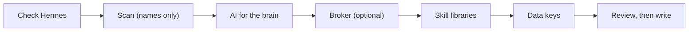

# Setup

> [!NOTE]
> Status: built and tested on Linux against a Hermes shim and Hermes 0.23.1. macOS and Windows are not covered. Not yet used by outside users.

**How to install Hermes and this tool, run `trading-agent setup`, and undo it.**

## At a glance

| Step | Command | Changes anything? |
|---|---|---|
| 1. Install Hermes (you run it) | `curl -fsSL https://hermes-agent.nousresearch.com/install.sh \| bash` | Installs Hermes |
| 2. Install this tool | `uv tool install "git+https://github.com/mphinance/trading-agent.git@portable-agent"` | Installs a command |
| 3. Look first (optional) | `trading-agent scan` | No |
| 4. Run the wizard | `trading-agent setup` | One new Hermes profile |
| 5. Undo | `trading-agent undo --profile <profile>` | Removes what step 4 made |

## In this doc

- [What you need](#what-you-need)
- [Step 1: install Hermes](#step-1-install-hermes)
- [Step 2: install the tool](#step-2-install-the-tool)
- [Why not run it from a checkout](#why-not-run-it-from-a-checkout)
- [Step 3: run setup](#step-3-run-setup)
- [What the wizard asks](#what-the-wizard-asks)
- [Undo](#undo)
- [If something goes wrong](#if-something-goes-wrong)

## What you need

- Linux (the only platform covered so far).
- Python 3.11.4 or newer (import and export rely on a tar extraction filter that earlier 3.11 releases lack).
- [uv](https://docs.astral.sh/uv/) or pipx, to install a Python command. If your system Python is older than 3.11.4 (Debian 12 ships 3.11.2), `uv tool install` fetches a suitable Python by itself, which is the easy route. With pipx, add `--python <path to a 3.11.4 or newer Python>`.
- Hermes 0.23.0 or newer. `distribution.yaml` says `hermes_requires: ">=0.23.0"`; Hermes refuses to install the profile on anything older.

## Step 1: install Hermes

The tool never installs Hermes and never runs this command. If Hermes is missing, the wizard prints it and waits. Run it yourself in a terminal:

```bash
curl -fsSL https://hermes-agent.nousresearch.com/install.sh | bash
hermes --version
```

```text
Hermes Agent v0.23.1 (2026.9.24) · stable · local 3b4215785882
Install directory: <home>/.hermes/hermes-agent
Install method: git
```

The version must be 0.23.0 or higher. If it is older, a normal (git) install updates with `hermes update`. If you installed Hermes another way, upgrade it the way you installed it. The tool never runs the update for you either. Windows and Termux installs are not covered here.

## Step 2: install the tool

Install the packaged tool from the `portable-agent` branch of the repository (that branch holds this project until the maintainer makes it the default; after that the `@portable-agent` suffix is dropped, see the [publish checklist](PUBLISH_CHECKLIST.md)). `uv tool install` from this address has not been run end to end by outside users [UNVERIFIED]:

```bash
uv tool install "git+https://github.com/mphinance/trading-agent.git@portable-agent"
trading-agent --help
```

`pipx install "git+https://github.com/mphinance/trading-agent.git@portable-agent"` works the same way. Both put a `trading-agent` command in `~/.local/bin`. If uv warns that this folder "is not on your PATH", run `uv tool update-shell` and open a new terminal (or add the folder to `PATH` yourself), otherwise `trading-agent: command not found`.

> [!NOTE]
> This install route was exercised through the built wheel in the tests (the wheel contains the three profile files), not yet from a public repository by an outside user.

## Why not run it from a checkout

The profile files (`distribution.yaml`, `SOUL.md`, `config.yaml`) ship inside the installed package. Setup hands Hermes a folder of those files to install.

If you run the tool straight from a working copy of the repository instead, that folder is the whole working copy. A working copy usually has a `.venv` full of symlinks, and `hermes profile install <dir>` refuses a folder that contains symlinks. So install from the repository address or from the wheel, as above. Do not point `hermes profile install` at a development checkout either.

## Step 3: run setup

Optional first look, names only:

```bash
trading-agent scan
```

```text
env:OPENROUTER_API_KEY | ai-key | present | OPENROUTER_API_KEY
env:ALPACA_API_KEY | broker-key | absent | ALPACA_API_KEY
mcp:claude-code | mcp-entry | absent |
cli:claude | ai-cli | absent | claude
ai-local:ollama | ai-local | absent | ollama
```

The excerpt above is shortened: a real run prints about 55 lines, one per thing it looked for (mostly `absent` on a clean machine): where, kind, present or absent, name. The full output is [scan.txt](transcripts/scan.txt); `trading-agent scan --json` prints the same as JSON. To find CLIs and shell-only variables, `scan` starts your login shell (so your shell startup files run) and runs `--version` on any AI CLI it finds. It reads the MCP config files of other apps (Claude Code, Claude Desktop) for server and variable names, and tries a few loopback ports. It sends nothing over the network.

Run the wizard. Flags are optional:

```bash
trading-agent setup
trading-agent setup --profile <profile>
```

`--profile` sets the new profile's name up front. Without it the wizard asks and suggests `trader`. The name uses lowercase letters, digits, hyphen or underscore, starts with a letter, and is at most 32 characters; names such as `hermes`, `default`, `test`, `tmp`, `root` and `sudo` are reserved. An existing profile is never overwritten.

You can go back one screen by typing `<`. Progress (decision names, never values) is saved to `~/.config/trading-agent/state.json`, so an interrupted setup can resume. That file and the receipt live under `$XDG_CONFIG_HOME` when it is set.

## What the wizard asks

Nothing is required. Skip any step and finish later.

To see every screen first, read the transcript of a real run against a test copy of Hermes: [setup.txt](transcripts/setup.txt) (Alpaca, fake key, keys shown as `[hidden]`). Four screens are also drawn as pictures: [first screen](assets/wizard-first-screen.svg), [found on this computer](assets/wizard-found.svg), [review](assets/wizard-review.svg) and [done](assets/wizard-done.svg). The transcript of `scan` is [scan.txt](transcripts/scan.txt).



Read the boxes left to right; no profile and no key is written before the last box, and only after you confirm it. The wizard does save its progress file as you go. The list below says what each box does.

- **Check Hermes.** Finds `hermes`, reads its version, checks it against `>=0.23.0`. If missing or too old, it prints the install or update hint and offers "Check again".
- **Scan.** Looks for AI tools, saved key names, other apps' MCP settings and local model ports. Reports presence by name only, never a value. Nothing is used yet.
- **AI for the brain.** Choose none, OpenRouter, Venice, a custom OpenAI-compatible service, or, when the scan found one running, Ollama or LM Studio. A signed-in AI CLI that the scan found cannot power the agent in this version; the wizard says so and leaves that sign-in untouched. A "keep it private" choice shows only a local model or Venice.
- **Broker.** The list comes from the [awesome-broker-mcp](https://github.com/mphinance/awesome-broker-mcp) catalog (browse it for every broker it knows; fixes to a broker entry are made there). Pick a broker MCP or "No broker, research only". The ten curated names are listed first, the full catalog is searchable. Only Alpaca and Tradier can be installed here; other entries show "setup details not curated yet" and where to set them up yourself.
- **Skill libraries.** Pick any or none. In this version the choice is recorded by name; nothing is downloaded.
- **Data keys.** Optional keys that your picks mention. Skip is fine.
- **Review.** A plain list of exactly what will happen: create the profile, write these key names into the private `.env`, record these picks, change nothing in any other app or profile. Choose "Do it" to write; "Back" changes nothing.

Menu numbers shift with what the scan found (for example the OpenRouter "Key found" entry only appears when that key exists), so read the label, not the number you saw in the transcript.

Keys: when the wizard needs a key it asks for it with a hidden prompt, or offers to copy one it found by name in your environment, one use at a time, and only if you say yes. See [KEYS](KEYS.md).

When it finishes, setup lists what was created, a "Left to finish later" list (for example "Pick an AI" or "Sign in to a broker on its own site"), who can read each key in the private `.env`, and the exact undo command. The setup receipt (names and locations only, never a value) is saved under your config folder, by default `~/.config/trading-agent/receipts/<profile>.json`.

## Undo

```bash
trading-agent undo --profile <profile>
```

`--profile` can be left out when exactly one profile has a receipt. Undo shows what it will remove and asks `Remove it? [y/N]` (default No). It removes what setup created, by the receipt, and only a profile folder that carries this tool's ownership marker (a hidden `.trading-agent-run` file whose id matches the receipt). That deletes the whole profile folder, memories included, and the `~/.local/bin/<profile>` command shortcut if Hermes made one (import makes one; a test run of `setup` on Hermes 0.23.1 made none). A profile you made yourself is left alone; when nothing is removed the exit status is 1. Details on keys: [KEYS](KEYS.md#removing-keys). A real run is in [undo.txt](transcripts/undo.txt).

## If something goes wrong

| What you see | What it means |
|---|---|
| "Hermes is installed, but it did not answer a version check" | Run `hermes --version` in a terminal, fix that, then choose Check again |
| "This setup needs Hermes >=0.23.0. You have ..." | `hermes update`, or upgrade the way you installed it |
| "You already have a profile called ..." | Pick another name; nothing was changed |
| "Setup did not finish" with a report | Setup rolls back what it made when it can, and says when it could not prove ownership and left something alone |

## Related docs

- [README](../README.md): what the tool is and what it does not include.
- [KEYS](KEYS.md): where keys live and how to remove them.
- [UPDATING](UPDATING.md): keeping the profile current.
- [MOVING](MOVING.md): carry the agent to a new computer.
- [T0 spike results](spike/T0-results.md): verified Hermes facts (install command, version pin).
