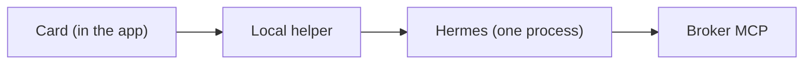

# Documentation style guide

> [!NOTE]
> Status: in force. This guide governs every page in this repo. If a page and this guide disagree, fix the page.

**Goal:** a page a stranger can skim in 30 seconds and trust in 5 minutes. Beautiful on GitHub, readable in a terminal, honest about what is and is not built.

## At a glance

- Every page: title, status callout, bold one-sentence purpose, body, Related docs.
- Over 100 lines: add At a glance. Over 150 lines: add `## In this doc`.
- Callouts sparingly; Mermaid for flows; every code block names a language.
- No em or en dashes, no private paths, hosts or keys, no filler.
- Each page gets six review passes, one lens each.

## In this doc

- [Page template](#page-template)
- [Callouts](#callouts)
- [Decision tags](#decision-tags)
- [Diagrams](#diagrams)
- [Tables, lists and code](#tables-lists-and-code)
- [Screenshots and transcripts](#screenshots-and-transcripts)
- [Voice](#voice)
- [Review lenses](#review-lenses)

## Page template

Every page, in this order:

1. **Title** (`# Title`), short and concrete. No "Overview of the".
2. A **status callout** (`> [!NOTE]`) with the status line, for example `Status: design phase, not built.`
3. A **one-sentence purpose** in bold under it. A reader who stops here still learns what the page is for.
4. An **At a glance** block (a short table or 3 to 5 bullets) on any page over 100 lines: the answer first, the detail below.
5. A **table of contents** (`## In this doc`) on any page over 150 lines, linking the `##` headings.
6. The body: `##` sections, `###` subsections, never skip a level.
7. **Related docs** at the bottom, as a short bulleted list of relative links, each with a few words on why to read it.

Keep one idea per section. Put the most important sentence of a section first. Prefer a table to a paragraph when you are comparing things. Prefer a diagram to a paragraph when you are describing a flow.

## Callouts

Use GitHub alert blocks, sparingly (at most one or two per screen):

```markdown
> [!NOTE]
> Context a reader can skip.

> [!TIP]
> A shortcut or a better way.

> [!IMPORTANT]
> Something the reader must not miss.

> [!WARNING]
> A risk, a footgun, or a limit that bites.

> [!CAUTION]
> Data loss or a security consequence.
```

## Decision tags

Pages use three tags so a reader always knows how firm a statement is. Render them the same way everywhere and keep the legend near the top of any page that uses them:

| Tag | Meaning |
|---|---|
| **[MICHAEL]** | The maintainer decided this. |
| **[CALL]** | A recommendation by the author. Not yet confirmed. |
| **[UNVERIFIED]** | Nobody has run or confirmed it. Say how to verify it. |

Never drop or reword a tag when editing. Never turn a [CALL] into a statement of fact.

## Diagrams

Use Mermaid. GitHub renders it. Keep each diagram small and legible:

- Flows and architecture: `flowchart LR` or `flowchart TD`, at most about 15 nodes, short labels, quote any label that contains punctuation (`A["Label (with parens)"]`).
- Wizard and lifecycle: `stateDiagram-v2`.
- Who talks to whom and in what order: `sequenceDiagram`.
- Never put secrets, real hostnames or private paths in a diagram.
- Add one sentence under each diagram saying what to look at. Keep an ASCII fallback only if the diagram is essential and the page may be read outside GitHub.

Example:

````markdown

````

## Tables, lists and code

- Tables: header row, 2 to 5 columns, short cells. Right-size them: a table with long paragraphs in cells should be a list.
- Lists: parallel structure, one idea per bullet, no more than about 7 bullets before grouping with a subheading.
- Collapse long reference material in `<details><summary>Plain label</summary> ... </details>` so the page stays scannable.
- Code blocks always carry a language (`bash`, `yaml`, `json`, `text`). Commands a reader should run go in `bash` blocks, one command per line, with no `$` prompt. Show expected output in a separate `text` block.
- Name files and commands in backticks. Link to a doc with a relative link and a descriptive label, never "click here".
- Never include real keys, tokens, hostnames, IP addresses or absolute local paths. Use obvious placeholders such as `sk-EXAMPLE` and `<profile>`.

## Screenshots and transcripts

- A wizard is a terminal program, so the honest screenshot is a **transcript**: real output from a real run (against the test shim), shown as a `text` block and, for the README hero, rendered as an SVG "terminal window" under `docs/assets/`.
- Every image has alt text that says what the reader should see, and a plain-text equivalent nearby for anyone who cannot see it.
- Never show a real secret, even a revoked one. Redact with `[hidden]`.
- Regenerate transcripts from code (a script in the repo), not by hand, so they cannot drift from the product.

## Voice

- Plain English, short sentences, active voice. Say what to do, then why.
- No em dashes or en dashes anywhere. Use commas, colons, semicolons, parentheses, or two sentences.
- No cheerleading and no filler openers ("Welcome to", "Simply", "Just", "Let's dive in"). No hype. Do not promise what is not built.
- Show the arithmetic when a number matters (`8 none files + 4 stubs = 12`).
- Define a term the first time it appears; this repo has no glossary page.
- Honesty over polish: if something is unknown, say so and say how to find out.

## Review lenses

Each page gets several passes, each with one lens, so no single reviewer has to hold everything:

| # | Lens | Question it answers |
|---|---|---|
| 1 | **Structure and visual** | Can I skim it? Is the template, hierarchy, tables, callouts and diagrams right? |
| 2 | **Newcomer** | Could someone who has never seen the project get from zero to the answer? Any undefined terms or missing steps? |
| 3 | **Accuracy** | Is every claim true of the code and the tests? Are commands runnable? Are unverified items tagged? |
| 4 | **Voice and copy** | Plain, kind, concise, free of dashes and filler? Consistent terms? |
| 5 | **Skeptic** | Does it over-promise on privacy, safety, or licensing? Would a hostile reader find a gap? |
| 6 | **Navigation** | Do links work, is there an index entry, is there a dead end, is the reading order obvious? |

## Related docs

- [Docs index](README.md): where every page lives.
