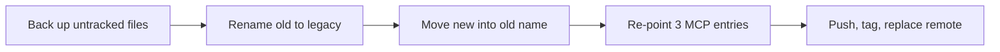

# Swap procedure

> [!NOTE]
> Status: not run. Maintainer page: users can skip it.

**How to replace the old `trading-agent` folder and repository with this project without losing the old untracked work, the old `.env`, or the three local MCP servers that still run from the old folder.**

> [!WARNING]
> **Every step below requires explicit maintainer confirmation; do not run from automation.** Step 5 is a force-push to a public remote.

## At a glance

| Step | What | Reversible? |
|---|---|---|
| 0 | Close Claude Code and Claude Desktop, note both folder paths | n/a |
| 1 | Back up the old repo's untracked and ignored files (not `.venv`) to a tarball outside it | Yes |
| 2 | Rename the old folder to `trading-agent-legacy` | Yes (rename back) |
| 3 | Move the new folder into the old name, rebuild its `.venv` | Yes |
| 4 | Re-point the `momentum`, `tickertrace` and `webull` MCP entries to the legacy folder | Yes (restore the backups) |
| 5 | Push the new branch, tag the old branch, then replace the old default branch | Partly: the old tip survives only if you tag it first |

## In this doc

- [Why this order](#why-this-order)
- [Placeholders](#placeholders)
- [Step 0: prepare](#step-0-prepare)
- [Step 1: back up](#step-1-back-up-untracked-and-ignored-files)
- [Step 2: rename the old folder](#step-2-rename-the-old-folder)
- [Step 3: move the new folder into place](#step-3-move-the-new-folder-into-place)
- [Step 4: re-point the MCP servers](#step-4-re-point-the-mcp-servers)
- [Step 5: replace the remote branch](#step-5-replace-the-remote-branch)
- [Rollback](#rollback)

## Why this order

The old folder still serves three local MCP servers (`momentum`, `tickertrace`, `webull`) to Claude Code and Claude Desktop, and holds uncommitted work and a local `.env` that exist nowhere else. So the new project was built in a separate folder on an orphan branch (clean history), and nothing is deleted. The swap keeps the old folder under a new name, so its servers keep working once their config paths are updated.



Read it left to right: each box is safe to stop after, except the last, which changes a public remote.

## Placeholders

| Placeholder | Meaning |
|---|---|
| `<old-repo>` | Full path of the current `trading-agent` folder |
| `<new-repo>` | Full path of the current `trading-agent-next` folder |
| `<parent>` | The folder that contains both |
| `<backup-dir>` | A folder outside both repositories, readable only by you |
| `<repo-url>` | The remote address, as in `git remote -v` (used only in this page's commands) |

## Step 0: prepare

Requires explicit maintainer confirmation; do not run from automation.

Close Claude Code and Claude Desktop completely. They read the MCP config at start and may rewrite it on exit, which would undo step 4.

```bash
git -C <old-repo> status --short
git -C <old-repo> remote -v
git -C <old-repo> rev-parse HEAD
git -C <new-repo> status --short
git -C <new-repo> branch --show-current
```

Write down the old `HEAD` hash; step 5 needs it. The new folder should be clean and on `portable-agent`.

## Step 1: back up untracked and ignored files

Requires explicit maintainer confirmation; do not run from automation.

This captures the local `.env` and any other file git does not track. It leaves out `.venv`, `node_modules` and `__pycache__`, which rebuild. The tarball will hold secrets, so it is created readable only by you and kept outside the repository.

```bash
umask 077
mkdir -p <backup-dir>
git -C <old-repo> ls-files -z --others | grep -zvE '(^|/)(\.venv|node_modules|__pycache__)/' | tar -C <old-repo> --null -T - -czf <backup-dir>/trading-agent-untracked.tgz
```

Verify the count and a sample before going on. The two numbers must match.

```bash
git -C <old-repo> ls-files -z --others | grep -zvE '(^|/)(\.venv|node_modules|__pycache__)/' | tr -cd '\0' | wc -c
tar -tzf <backup-dir>/trading-agent-untracked.tgz | grep -vc '/$'
ls -l <backup-dir>/trading-agent-untracked.tgz
```

`ls-files --others` without `--exclude-standard` lists ignored files too, which is the point. Also copy any tracked file with uncommitted edits if `git status` showed them: `git -C <old-repo> diff > <backup-dir>/old-tracked.diff`.

## Step 2: rename the old folder

Requires explicit maintainer confirmation; do not run from automation.

```bash
mv <parent>/trading-agent <parent>/trading-agent-legacy
```

The three MCP servers are down from here until step 4 is done. The old virtual environment keeps working only if it does not hard-code the old path; if a server fails to start after step 4, recreate that environment inside `trading-agent-legacy`.

## Step 3: move the new folder into place

Requires explicit maintainer confirmation; do not run from automation.

```bash
mv <parent>/trading-agent-next <parent>/trading-agent
cd <parent>/trading-agent
uv sync
```

A virtual environment records absolute paths, so the move breaks the old `.venv`; `uv sync` rebuilds it. Check:

```bash
uv run trading-agent --help
git status --short
```

## Step 4: re-point the MCP servers

Requires explicit maintainer confirmation; do not run from automation. Claude Code and Claude Desktop must both be closed.

Two files hold the entries. Back both up first.

| App | File |
|---|---|
| Claude Code | `~/.claude.json` |
| Claude Desktop | `~/.config/Claude/claude_desktop_config.json` |

```bash
cp ~/.claude.json ~/.claude.json.before-swap
cp ~/.config/Claude/claude_desktop_config.json ~/.config/Claude/claude_desktop_config.json.before-swap
grep -n "trading-agent" ~/.claude.json ~/.config/Claude/claude_desktop_config.json
```

These backups hold your configuration, possibly keys; keep their mode private (`chmod 600`) and delete them when the swap is confirmed good.

Edit the `command`, `args`, `cwd` or `env` path of the `momentum`, `tickertrace` and `webull` entries so each points under `<parent>/trading-agent-legacy` instead of `<parent>/trading-agent`. In `~/.claude.json` the entries can appear under the top-level `mcpServers` and again under each project's `mcpServers`; change every occurrence. Do not touch any other entry.

Verify there are no old-path leftovers, then validate the JSON:

```bash
grep -n "trading-agent" ~/.claude.json ~/.config/Claude/claude_desktop_config.json
python3 -c "import json,os; [json.load(open(os.path.expanduser(p))) for p in ('~/.claude.json','~/.config/Claude/claude_desktop_config.json')]; print('both parse')"
```

```text
both parse
```

Every remaining `trading-agent` match must say `trading-agent-legacy`. Start Claude Code and Claude Desktop and confirm the three servers connect.

## Step 5: replace the remote branch

Requires explicit maintainer confirmation; do not run from automation. This is outward-facing. Do it only after [PUBLISH_CHECKLIST](PUBLISH_CHECKLIST.md) is fully ticked.

First push the new work as a new branch. Nothing existing is touched.

```bash
git -C <parent>/trading-agent remote -v
git -C <parent>/trading-agent push -u origin portable-agent
```

Then keep a way back: tag the old default branch tip with the hash you wrote down in step 0, and push the tag.

```bash
git -C <parent>/trading-agent-legacy tag legacy-main-final <old-head-hash>
git -C <parent>/trading-agent-legacy push origin legacy-main-final
```

Then replace the old default branch. `--force-with-lease` with the old hash fails if anyone pushed in between.

```bash
git -C <parent>/trading-agent push --force-with-lease=main:<old-head-hash> origin portable-agent:main
```

The branch history of the new project is unrelated to the old one (an orphan branch), which is why a force-push is needed. Check the result in the repository's web page, then, if wanted, delete the extra `portable-agent` remote branch.

After step 5 makes this the default branch, drop the `@portable-agent` suffix from every install command in the docs (`git grep -n "@portable-agent"`) and re-run `tests/test_docs.py`.

## Rollback

| Failed at | Undo |
|---|---|
| Step 1 | Delete the tarball; nothing else changed |
| Step 2 or 3 | `mv <parent>/trading-agent <parent>/trading-agent-next` (if step 3 ran), then `mv <parent>/trading-agent-legacy <parent>/trading-agent` |
| Step 4 | Close both apps, then copy each `.before-swap` file back over its original |
| Step 5, new branch only | `git push origin --delete portable-agent` |
| Step 5, after the force-push | `git push --force-with-lease origin legacy-main-final:main` restores the old default branch tip from the tag |

To get the untracked files back after a rename mistake, extract the step 1 tarball into the restored old folder:

```bash
tar -C <old-repo> -xzf <backup-dir>/trading-agent-untracked.tgz
```

Keep the tarball and the `.before-swap` files until you have used the old servers and the new repository for a few days, then delete them.

## Related docs

- [Publish checklist](PUBLISH_CHECKLIST.md): must be complete before step 5.
- [README](../README.md): what the new project is.
- [Docs index](README.md): all pages.
